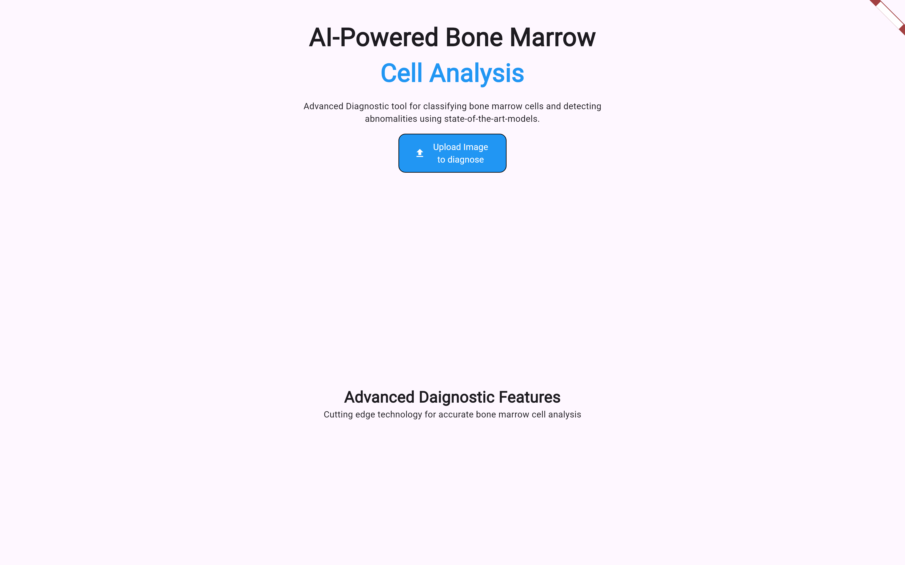
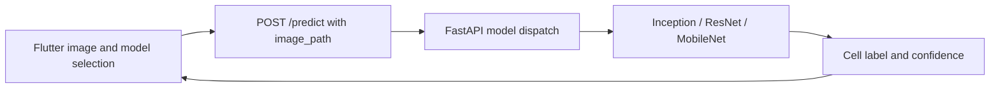

# Marrow Insight

A Flutter and FastAPI research prototype for bone marrow cell image classification. The interface lets a user select an image and choose an Inception, ResNet, or MobileNet model, then displays the predicted cell label and confidence.

## Interface preview

The responsive diagnostic workspace introduces the image-analysis flow before model selection and inference:



## Stack and architecture

Flutter / Dart `^3.8.1`, `image_picker`, `http`, and `percent_indicator` form the client. Python, FastAPI, Pydantic, TensorFlow/Keras, NumPy, and pandas form the inference service.



The backend currently receives a filesystem path, not uploaded image bytes. That path must exist on the server. Changing the API hostname alone will not make an image selected on a separate phone accessible to the backend.

## Before running

This checkout requires additional model artifacts and local configuration:

1. Obtain the trusted trained Keras models. No `.keras` model files are included in this repository.
2. Update `MODEL_PATH` in `backend/prediction.py`, `backend/Resnet_predictor.py`, and `backend/Mobilenet_predictor.py`. They currently point at an author-specific Windows drive.
3. Provide all three models: they load when the API imports the predictor modules, regardless of which model a request selects.
4. Create a compatible TensorFlow/Python environment. `backend/requirements.txt` is currently empty, so there is no reproducible pinned backend installation.

## Development setup

```sh
git clone https://github.com/Abdul-Hadi-Jalil/Marrow-Insight.git
cd Marrow-Insight
python -m venv backend/.venv
```

Activate the environment and install the directly imported dependencies below. This is a starting dependency list, not a validated compatibility lock; TensorFlow must match the model export environment.

```sh
python -m pip install fastapi uvicorn tensorflow numpy pandas
cd backend
python -m uvicorn main:app --reload --host 0.0.0.0 --port 8000
```

In another terminal:

```sh
cd frontend
flutter pub get
flutter devices
flutter run -d <device-id>
```

The frontend calls `http://127.0.0.1:8000/predict` in `frontend/lib/screens/home_screen.dart`. A desktop client on the server machine is the simplest environment for the existing shared-path contract. A remote/mobile workflow needs an upload endpoint and server-side file handling before it can work reliably.

## API and model details

`POST /predict` accepts:

```json
{"model_name": "MobileNet", "image_path": "C:/demo/cell.png"}
```

Use the exact model names `Inception`, `ResNet`, or `MobileNet`. The response has `cell_type` and `confidence`. The classifiers use six labels: `ART`, `BLA`, `EBO`, `LYT`, `NGS`, and `PMO`. Each predictor owns its preprocessing; MobileNet uses 224×224 inputs and MobileNetV2 preprocessing, while the Inception module uses 150×150 inputs scaled to 0–1.

## Code map and verification

- `frontend/lib/screens/home_screen.dart`: image selection, model actions, results.
- `backend/main.py`: request schema and predictor dispatch.
- `backend/*predict*.py`: model loading and image preprocessing.

Run `flutter analyze` and `flutter test` from `frontend/`, then test `/docs` with a server-local image once the models are supplied. Unsupported model names and remote image transfer need implementation work.

This is a research demonstration. Confidence is a model output, not clinical accuracy or a diagnosis; clinical validation and documented evaluation are outside the demonstrated scope.
